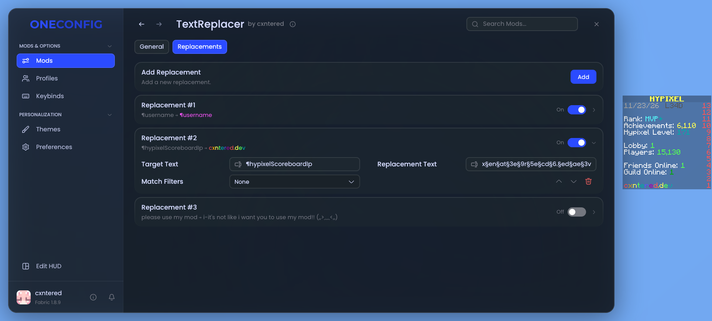

# `TextReplacer`

A mod using OneConfig to visually replace any text.

## Variables

TextReplacer supports variables in both the text you want to match and the replacement text. These variables are automatically replaced with their current values.  
For example, you can use variables to change the color of your username or replace the server IP displayed in the scoreboard. To use a variable, prefix its name with the pilcrow sign (`¶`).

**Available variables:** `username`, `serverIp`, `serverDomain`, `hypixelScoreboardIp`  
If you have an idea for a new variable, [create an issue!](https://github.com/cxntered/TextReplacer/issues)
